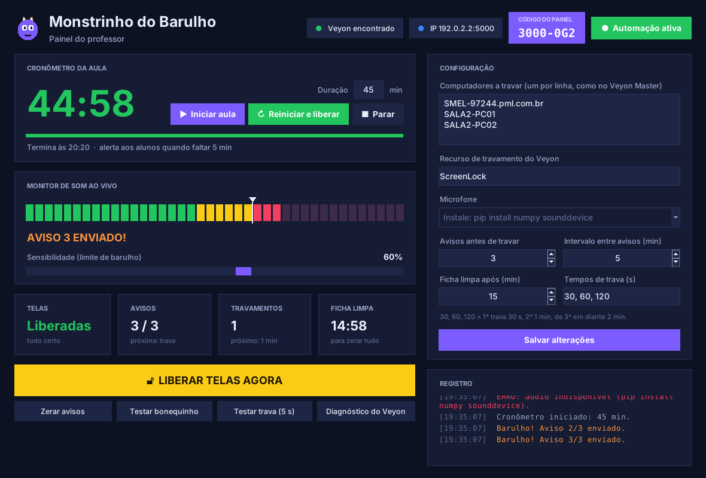
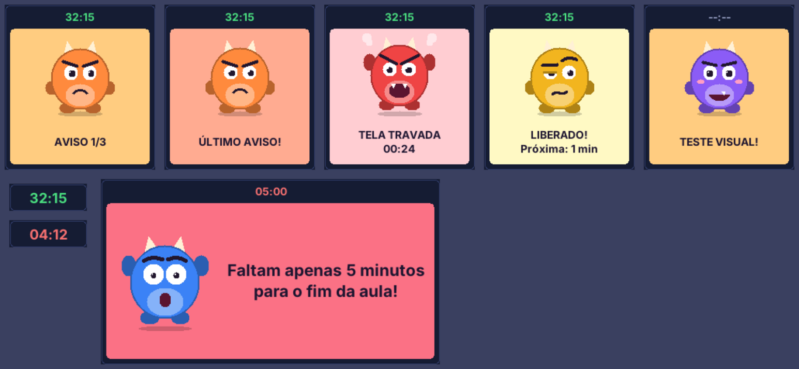
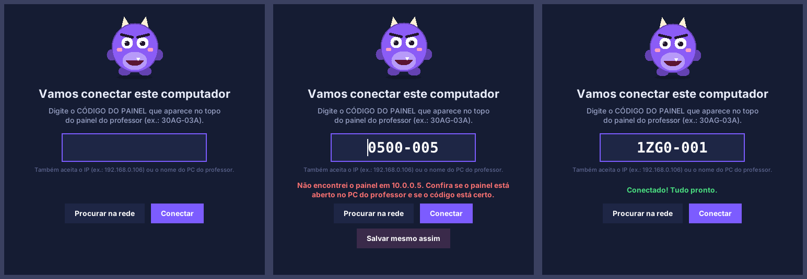
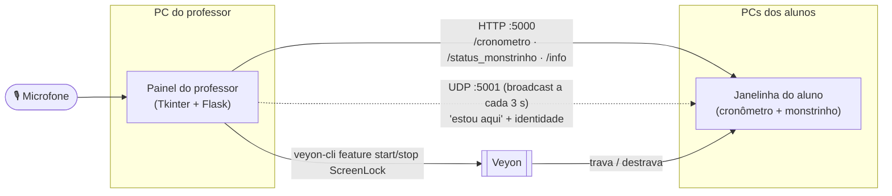

<p align="center">
  
</p>

<p align="center">
  
  
  
  
</p>

<p align="center">
  <b>O microfone do professor ouve a sala. O monstrinho avisa os alunos.<br>
  Se o barulho continuar, as telas travam por alguns segundos e destravam sozinhas.</b>
</p>

---

## ✨ O que ele faz

| | |
|---|---|
| 🎙️ **Mede o barulho em tempo real** | O PC do professor escuta pelo microfone, com sensibilidade ajustável. Nada é gravado. |
| 👾 **Avisos com o monstrinho** | Um monstrinho animado aparece no canto da tela dos alunos: *Aviso 1/3 → 2/3 → Último aviso!* |
| 🔒 **Travamentos progressivos** | Depois dos avisos, as telas travam pelo **Veyon** por **30 s → 1 min → 2 min** e destravam sozinhas. |
| ✨ **Ficha limpa** | Depois de 15 min sem avisos, tudo volta ao zero. |
| ⏱️ **Cronômetro de aula** | O tempo aparece em cada PC, com **alerta aos 5 minutos** e trava automática em 00:00. |
| 🔓 **Professor no controle** | Liberar telas, reiniciar aula, pausar a automação e testar tudo a qualquer momento. |
| 📡 **Conexão automática** | O aluno digita um **código curto** uma única vez. Depois o programa abre com o Windows e **reencontra o professor sozinho**, mesmo se o IP mudar. |
| 📦 **Instaladores prontos** | Um instalador para o professor e outro para os alunos, sem precisar de Python. |

## 📸 Telas

<p align="center">
  <br>
  <sub><b>Painel do professor</b>: cronômetro, medidor de som, situação da turma, configurações e registro.</sub>
</p>

<p align="center">
  <br>
  <sub><b>Janela do aluno</b>: discreta acima do relógio do Windows. O monstrinho muda de humor conforme a situação.</sub>
</p>

<p align="center">
  <br>
  <sub><b>Primeira abertura no aluno</b>: digita o código do painel, testa a conexão e salva.</sub>
</p>

## ⚙️ Como funciona



**Regras do barulho (padrão, tudo ajustável no painel):**

```
barulho acima do limite ──► Aviso 1/3 ──► Aviso 2/3 ──► ÚLTIMO AVISO!
(respeitando 5 min de intervalo entre eles)
        ──► trava 30 s ──► trava 1 min ──► trava 2 min ──► trava 2 min ...
15 min sem avisos ──► ficha limpa (volta ao zero)
```

| Humor | Quando aparece |
|---|---|
| 🟠 **Bravo** | Avisos 1, 2 e o último aviso |
| 🔴 **Furioso** (treme e solta fumaça) | Tela travada por barulho, com contagem regressiva |
| 🟡 **Desconfiado** | Logo depois de destravar: *"Liberado! Próxima: 1 min"* |
| 🟣 **Travesso** | Testes do professor |
| 🔵 **Assustado** (com "!" piscando) | *"Faltam apenas 5 minutos para o fim da aula!"* |

## 🚀 Instalação

### Opção 1: baixar os instaladores prontos
Na aba **[Releases](../../releases)** (ou em **Actions → último build → Artifacts**) baixe:

- `Instalar_Monstrinho_Professor.exe`: no PC do professor
- `Instalar_Monstrinho_Aluno.exe`: em cada PC de aluno

### Opção 2: gerar você mesmo (Windows)
Pré-requisitos: **Python 3 (64 bits)** e **[Inno Setup 6.3+](https://jrsoftware.org/isdl.php)**.

```bat
scripts\gerar_instalador.bat
```

Os dois instaladores ficam na pasta `release\`.

### Passo a passo na escola
1. **Professor:** instale o [Veyon](https://veyon.io) (com o *Veyon Master*) e rode `Instalar_Monstrinho_Professor.exe`.
   Abra o painel e anote o **CÓDIGO DO PAINEL** (caixa roxa no topo, ex.: `30AG-03A`).
2. **Alunos:** rode `Instalar_Monstrinho_Aluno.exe` em cada PC (precisa de administrador). Aceite as regras de uso.
   Na primeira abertura, digite o código do painel.
3. **Pronto.** A partir daí o programa do aluno abre sozinho a cada login e se conecta ao painel.

> 💡 Guia completo, uso no dia a dia e solução de problemas do Veyon: **[docs/GUIA.md](docs/GUIA.md)**

## 🧑‍💻 Desenvolvimento

```bash
pip install -r requirements-dev.txt
python src/servidor_veyon.py        # painel do professor
python src/cliente_aluno.pyw        # programa do aluno (pede o código na 1ª vez)
pytest -q                           # testes automatizados
```

O programa do aluno aceita `--configurar` (abre a tela do código) e `--ip <endereço>` (ignora a configuração salva).

### Estrutura do projeto

```
monstrinho-do-barulho/
├── src/
│   ├── servidor_veyon.py        # painel do professor: lógica, API Flask, Veyon e interface
│   └── cliente_aluno.pyw        # programa do aluno: janelinha, monstrinho, conexão, configuração
├── installer/
│   ├── instalador_professor.iss # Inno Setup: instalador do professor
│   ├── instalador_aluno.iss     # Inno Setup: instalador do aluno
│   ├── regras_de_uso.txt        # tela "Eu aceito" do instalador do aluno
│   ├── informacoes_professor.txt
│   ├── monstrinho.ico
│   └── imagens/                 # imagens dos assistentes de instalação
├── scripts/
│   ├── gerar_instalador.bat     # gera os dois instaladores (PyInstaller + Inno Setup)
│   ├── gerar_exe_aluno.bat      # versão portátil do aluno, sem instalador
│   └── instalar_no_aluno.bat
├── tests/                       # pytest: regras, cronômetro, API, código e reconexão
├── docs/                        # guia completo e imagens
└── .github/workflows/ci.yml     # testes + build dos instaladores no Windows
```

### API do painel

| Rota | Resposta |
|---|---|
| `GET /cronometro` | `{"ativo": true, "tempo_restante": 2689, "encerrada": false}` |
| `GET /status_monstrinho` | `{"mostrar": true, "rosto": "😠", "mensagem": "AVISO 1/3", "cor": "#ffcc80", "alerta": false}` |
| `GET /info` | `{"app": "monstrinho", "id": "1ad4a6dfe617", "pc": "SALA-PROF", "codigo": "30AG-03A"}` |

O **código do painel** é o IPv4 do professor em 7 caracteres base32 (alfabeto Crockford, sem `I L O U`).
Já o **id** é fixo: é gerado uma vez e guardado em `C:\ProgramData\Monstrinho`. É ele que permite ao aluno
reencontrar *o mesmo* professor quando o IP muda, sem conectar no painel de outra sala.

## 🔐 Privacidade

- O áudio é usado só para medir o volume, na hora. **Nada é gravado.**
- O programa do aluno **não usa** microfone nem câmera.
- Toda a comunicação fica na rede local da escola. Nada vai para a internet.

## 📄 Licença

[MIT](LICENSE). Use, adapte e compartilhe à vontade.
